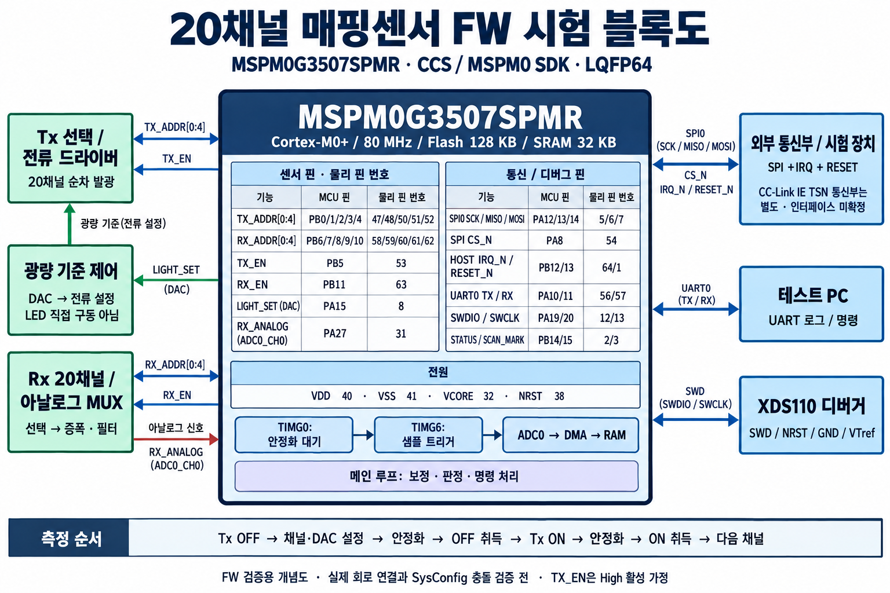
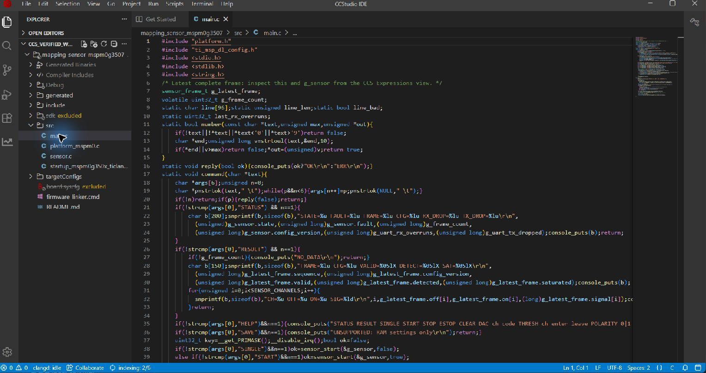

# TI MCU 매핑센서 FW 시험 프로젝트

MSPM0G3507SPMR 기반 20채널 Tx/Rx 순차 제어와 DAC 광량 조절을 검증하는 CCS용 FW입니다.

- [사용법·핀 배치·UART 시험 순서](mapping_sensor_fw/README.md)
- [내부 검증 결과](mapping_sensor_fw/VALIDATION.md)
- [CCS 프로젝트 가져오기](mapping_sensor_fw/mapping_sensor.projectspec)
- [V2 블록별 구조·API 설계](mapping_sensor_fw/ARCHITECTURE_V2.md)
- [V2 다운로드용 OUT](releases/v0.2/mapping_sensor.out) / [Intel HEX](releases/v0.2/mapping_sensor.hex)
- [V2 응용·프로토콜 에뮬레이션 결과](releases/v0.2/test_results.json)
- [V2 실제 드라이버 레지스터 계약 검사](releases/v0.2/driver_test_results.json)
- [V2 생성 설정·ELF 검사 결과](releases/v0.2/artifact_checks.json)

V2는 19개 C 파일을 블록별로 분리했습니다. CCS 21.0.1 자체 빌드: 오류 0 / 경고 0. 응용·프로토콜 통합 ARM 시험: 15 시나리오 / 15,933 assertion, 실제 드라이버 레지스터 계약 시험: 6 시나리오 / 42 assertion 통과. 생성 설정·ELF 검사: 35개 통과. 레지스터 시험은 메모리로 치환한 레지스터에 값을 주입하는 방식이며 실제 주변장치 시뮬레이션은 아닙니다.

MCU 라이팅과 실물 검증은 수행하지 않았습니다. 아날로그 파형·실제 주변장치 타이밍은 보드 시험이 필요합니다. 설정은 RAM 전용이며 CC-Link IE TSN 통신 스택과 자동 광량 보정은 포함하지 않습니다.

## CCS에서 열기

저장소를 내려받아 `mapping_sensor_fw/mapping_sensor.projectspec`을 CCS 프로젝트 가져오기에서 선택합니다. 필요한 TI SDK 헤더·DriverLib·시작 파일과 검증된 생성 설정이 포함되어 있습니다. `.syscfg`는 자동 빌드에서 제외되어 있습니다.

독립 빌드 및 SysConfig 재생성에는 MSPM0 SDK 2.11.00.07 전체가 필요합니다. 이 저장소에는 전체 SDK 대신 CCS 빌드에 필요한 파일만 포함합니다. `build.ps1 -SdkRoot <SDK 경로>`로 지정할 수 있습니다. 생성 파일 패키지를 갱신할 때는 `python tools/prepare_ccs.py --sdk-root <SDK 경로>`를 사용합니다. 테스트 실행 시 Python과 Unicorn 2.1.4, pyelftools 0.32가 필요합니다.

현재 버전은 `releases/v0.2`입니다. `releases/v0.1`은 이전 빌드의 고정 산출물로 유지합니다. 재빌드하면 새 산출물은 `mapping_sensor_fw/build`에 생성됩니다. 전체 SDK, Python 실행 의존성, CCS 임시 작업공간은 Git에서 제외했습니다.

## 실물 테스트 체크리스트: XDS110 → CCS 라이팅 → UART 20채널

아래 체크박스는 **사용자가 보드에서 수행할 절차**이며, 이미 실물 시험을 통과했다는 뜻이 아닙니다. MCU는 **MSPM0G3507SPMR / LQFP64** 기준입니다. 채널 번호는 **0~19**, TX_EN/RX_EN은 **High 활성**, Tx와 Rx는 각각 외부 5비트 선택 회로를 사용합니다.

### 1. 준비와 보드 확인

- [ ] XDS110, USB 데이터 케이블, 보드 전원, 3.3V 로직 USB-UART, 시리얼 터미널을 준비한다.
- [ ] CCS 21.0.1과 TI Arm Clang 5.1.1.LTS가 설치되어 있는지 확인한다.
- [ ] MCU 실물 품번과 핀 1 방향을 확인한다. 아래 숫자는 MCU **물리 핀 번호**이며 PINCM 번호가 아니다.
- [ ] 배선 전 보드 전원과 USB-UART 전원을 끈다.
- [ ] MCU 전원은 3.3V, VSS는 GND이며 VCORE는 외부 전원에 연결되지 않았는지 확인한다.
- [ ] Tx 드라이버에는 하드웨어 전류 제한과 리셋 중 발광을 막는 TX_EN 풀다운이 있는지 확인한다.
- [ ] PA27 ADC 입력이 0~VDD 범위인지 확인한다. 이번 FW의 DAC는 LED를 직접 구동하지 않고 광량 기준 회로를 제어한다.

### 2. XDS110 배선

| 확인 | XDS110 신호 | MCU / 보드 연결 |
|---|---|---|
| ☐ | SWDIO/TMS | PA19, **12번** |
| ☐ | SWCLK/TCK | PA20, **13번** |
| ☐ | nRESET | NRST, **38번** |
| ☐ | GND | 보드 GND, MCU VSS **41번**과 같은 접지 |
| ☐ | VTref | 보드 3.3V 레일, MCU VDD **40번**과 같은 전원 |

VTref는 타깃 전압 감지용으로 연결하며, 여기서는 **보드에 별도 전원을 공급**한다. USB-UART의 전원 핀은 연결하지 않아 전원 공급원이 중복되지 않게 한다.

- [ ] 사용하는 XDS110 커넥터/어댑터의 신호 라벨을 확인한다. **ARM 10핀과 CTI20은 핀 번호가 다르다.**
- [ ] ARM 10핀 어댑터라면 VTref=1, SWDIO=2, SWCLK=4, nRESET=10, GND=3·5를 확인한다. 커넥터 핀 1 표시를 기준으로 배선한다.
- [ ] LaunchPad 내장 XDS110을 외부 보드에 쓰는 경우 해당 보드 설명서에 따라 온보드 MCU와의 SWD 연결을 분리한다.
- [ ] 배선 후 보드 전원을 켜고 VDD–GND에서 약 3.3V가 나오는지 측정한다.
- [ ] XDS110 USB를 PC에 연결하고 장치 관리자에서 인식되는지 확인한다.

커넥터 번호 근거: [TI JTAG/SWD 커넥터 핀맵](https://software-dl.ti.com/ccs/esd/documents/xdsdebugprobes/emu_jtag_connectors.html).

### 3. CCS 프로젝트와 Flash 다운로드

- [ ] CCS의 **File → Import Projects**에서 `mapping_sensor_fw/mapping_sensor.projectspec`을 가져온다. 이미 열린 경우 `mapping_sensor_mspm0g3507 [Debug]`를 선택한다.
- [ ] **Build Project**를 실행하고 오류/경고가 없는지 확인한다. 성공한 빌드의 `Debug/mapping_sensor_mspm0g3507.out`을 사용한다.
- [ ] `targetConfigs/MSPM0G3507.ccxml`을 열어 Device=`MSPM0G3507`, Connection=`Texas Instruments XDS110 USB Debug Probe`, 인터페이스=`SWD`, 클록=`1MHz`를 확인한다.
- [ ] **Properties → Debug → MSPM0 Flash Settings**에서 삭제 범위를 **Erase MAIN memory only**로 선택한다. 이번 시험은 NONMAIN/BCR/BSL을 변경하지 않는다.
- [ ] **Debug Project**를 실행하고 Flash 다운로드가 성공하는지 확인한다. 파일을 물으면 위 `Debug` 폴더의 `.out`을 지정한다.
- [ ] 직접 파일을 선택해 다운로드한다면 저장소의 `releases/v0.2/mapping_sensor.out`도 사용할 수 있다. 수정 후 재빌드한 FW와 고정 릴리스 파일을 혼동하지 않는다.
- [ ] `main()`에서 멈추면 **Resume/Continue**를 눌러 실행한다. 이후 UART 시험 동안 CPU를 실행 상태로 둔다.

다운로드 후에는 보통 `main()`에서 정지한다. 멈춘 상태에서는 UART 응답이 없으므로 먼저 실행 상태를 확인한다. 실행 중 브레이크포인트로 멈추면 타이머·ADC·워치독에 영향을 줄 수 있어 첫 동작 시험은 중단점 없이 진행한다.

Flash 설정 근거: [TI MSPM0 CCS 안내 — Using TI XDS Tools / Flash Loader](https://software-dl.ti.com/msp430/esd/MSPM0-SDK/latest/docs/english/tools/ccs_theia_ide_guide/doc_guide/doc_guide-srcs/ccs_theia_ide_guide.html#using-ti-xds-tools).

### 4. UART 연결과 부팅 확인

전원을 끈 상태에서 아래와 같이 **TX/RX를 교차 연결**한다. 이 절차는 XDS110 AUX COM 대신 별도 USB-UART를 사용한다.

| 확인 | MCU 신호 | USB-UART 연결 |
|---|---|---|
| ☐ | PA10, **56번**, UART0 TX | RX |
| ☐ | PA11, **57번**, UART0 RX | TX |
| ☐ | 보드 GND | GND |

- [ ] USB-UART가 **3.3V 로직**인지 확인한다. RS-232 전압 신호를 직접 연결하지 않는다.
- [ ] 보드 전원을 켜고 터미널에서 USB-UART의 COM 포트를 선택한다.
- [ ] **115200bps / 8 data bits / No parity / 1 stop bit / 흐름제어 없음**으로 설정한다.
- [ ] 송신 줄 끝을 CR 또는 LF로 설정한다. 명령은 대문자 ASCII로 한 줄씩 보내고 응답을 기다린다.
- [ ] 터미널을 연 상태에서 보드를 리셋하고 아래 부팅 메시지를 확인한다.

```text
MAPPING20 FW 0.2 READY / IDLE / RAM CONFIG
```

- [ ] `HELP`를 보내 명령 목록이 나오는지 확인한다.
- [ ] `STATUS`를 보내 리셋 직후 `STATE=0 FAULT=0 FRAME=0 CFG=1 RX_DROP=0 TX_DROP=0`인지 확인한다.
- [ ] 측정 전 `RESULT`를 보내면 `NO_DATA`가 나오는지 확인한다.

`STATE`는 0=대기, 1=채널 안정화 대기, 2=OFF 취득, 3=발광 안정화 대기, 4=ON 취득, 5=오류이다. 연속 측정 중에는 조회 순간에 따라 0~4가 나올 수 있다.

### 5. 20채널 단발 측정

다음 명령은 한 줄씩 보낸다. `SINGLE`의 `OK`는 요청 수락이며 측정 완료를 의미하지 않으므로 **약 0.1초 후** `RESULT`를 보낸다.

```text
SINGLE
RESULT
STATUS
```

- [ ] `SINGLE`에 `OK`가 오는지 확인한다.
- [ ] `RESULT`에 프레임 요약 1줄과 **CH=0부터 CH=19까지 총 20개 채널 줄**이 나오는지 확인한다.
- [ ] 리셋 이후 첫 단발 측정이라면 `FRAME=1`인지 확인한다.
- [ ] 정상 입력 조건에서 `VALID=FFFFF`, `SAT=00000`, `FAULT=0`인지 확인한다.
- [ ] `OFF`와 `ON` 값이 0~4095 범위이고 `SIG`가 표시되는지 확인한다.
- [ ] `RX_DROP`, `TX_DROP`이 0인지 확인한다. 결과 전송 중 다음 `RESULT`를 연속으로 보내지 않는다.

출력 형식 예시이며 숫자는 **실측 결과가 아니다**:

```text
FRAME=1 CFG=1 VALID=FFFFF DETECT=00000 SAT=00000
CH=0 OFF=100 ON=900 SIG=800
...
CH=19 OFF=100 ON=900 SIG=800
```

| 필드 | 해석 / 판정 |
|---|---|
| VALID | 20비트 채널 유효 표시. `FFFFF`는 20채널 모두 유효 |
| SAT | OFF/ON 블록에 ADC 상한 4095 샘플이 있던 채널 표시. 정상 비포화 조건은 `00000` |
| OFF / ON | Tx OFF/ON에서 각각 4개 샘플의 정수 평균 |
| SIG | 극성·오프셋·이득을 적용한 신호. 기본은 ON−OFF |
| DETECT | 임계값 판정 비트. 최하위 bit0=CH0, bit19=CH19 |

초기 판정은 **2프레임 연속 확인**이므로 첫 단발 측정에서 SIG가 높아도 DETECT가 0일 수 있다. VALID는 센서 연결 자체를 진단하는 값이 아니다. 입력을 개방한 상태에서 VALID만 보고 정상으로 판단하지 않는다.

### 6. 연속 측정과 정지

- [ ] `START`를 보내 `OK`를 확인한다.
- [ ] 약 1초 후 `STATUS`를 보내고, 다시 약 1초 후 `STATUS`를 보내 **FRAME 증가**와 `FAULT=0`을 확인한다.
- [ ] `STOP`을 보내고 약 0.1초 기다린다. 현재 채널이 끝나면 정지하며 미완성 프레임은 버린다.
- [ ] `STATUS`를 두 번 조회해 `STATE=0`이고 FRAME이 더 이상 증가하지 않는지 확인한다.
- [ ] `RESULT`로 마지막 **완료된** 프레임을 확인한다. STOP 직전 일부 측정한 프레임은 공개하지 않는다.
- [ ] 다시 `START` 후 `ESTOP`을 보내고 `STATE=0`으로 돌아오는지 확인한다.
- [ ] 가능하면 오실로스코프로 ESTOP 후 TX_EN(PB5, 53번)이 Low가 되는지 확인한다.

`ESTOP`은 UART 명령이 파싱될 때 실행되는 **소프트웨어 정지**이다. 독립적인 하드웨어 비상정지 기능은 아니다. 결과는 자동 스트리밍되지 않으며 `RESULT`를 보낼 때만 출력된다.

### 7. 광량·극성·채널 선택 확인

- [ ] `STOP` 후 광량 드라이버의 허용 전류를 확인한다. 기본 DAC 코드는 모든 채널 512이며 이 코드가 안전한 전류인지는 회로에 따라 확인한다.
- [ ] `DAC 0 256` → `SINGLE` → 0.1초 대기 → `RESULT`를 수행하고 CH0 값을 기록한다.
- [ ] 허용 전류 범위에서 `DAC 0 512`로 바꾸고 같은 절차를 반복한다. PA15(8번)의 채널별 DAC 파형과 CH0 ON/OFF 차분의 변화를 확인한다.
- [ ] `DAC` 명령은 지정한 채널만 바꾼다는 점을 확인한다. CH19 시험은 `DAC 19 256`처럼 지정한다.
- [ ] 발광 시 수신값이 감소하는 회로라면 `POLARITY 0`(OFF−ON), 증가하는 회로라면 `POLARITY 1`(ON−OFF)을 적용한다.
- [ ] 필요하면 `THRESH 0 500 400`으로 CH0의 진입/해제 임계값을 설정한다. 해제값은 진입값보다 작아야 한다.
- [ ] 임계값 판정은 `START`로 2프레임 이상 측정한 후 확인한다. 설정 변경 후에는 연속 확인 카운트가 초기화된다.
- [ ] 실제 각 채널에 신호를 가해 해당 채널의 OFF/ON/SIG가 바뀌는지 확인한다. 다른 채널이 바뀌면 MUX/디코더 배선과 채널 순서를 확인한다.
- [ ] 확인한 채널을 기록한다: CH0 ☐ CH1 ☐ CH2 ☐ CH3 ☐ CH4 ☐ CH5 ☐ CH6 ☐ CH7 ☐ CH8 ☐ CH9 ☐ CH10 ☐ CH11 ☐ CH12 ☐ CH13 ☐ CH14 ☐ CH15 ☐ CH16 ☐ CH17 ☐ CH18 ☐ CH19 ☐

설정 명령의 OK는 수락을 의미한다. 동작 중 변경한 값은 다음 프레임에 적용되므로 STATUS/RESULT의 CFG 버전으로 적용 여부를 확인한다. DAC는 공유 출력이므로 연속 스캔 중 전압계에는 채널 전환 값의 평균처럼 보일 수 있다. 전원 재투입 시 RAM 설정은 기본값으로 돌아간다.

**광학 회로 없이 시험할 경우:** 수신 회로의 출력과 충돌하지 않도록 분리한 뒤 PA27(31번)에 범위 내의 알려진 전압을 넣어 ADC 응답을 확인한다. 고정 전압이면 OFF≈ON, SIG≈0이 정상이다. 이 시험은 공통 ADC 취득 경로만 확인하므로 실제 20개 광학 경로의 동작 증명은 아니다.

### 8. 파형 확인과 오류 대응

- [ ] 로직 분석기/오실로스코프가 있다면 TX_ADDR=PB0~4, RX_ADDR=PB6~10에서 **0~19 순회**를 확인한다. 미사용 주소 20~31은 나오지 않아야 한다.
- [ ] TX_EN(PB5, 53번)이 주소 전환 중 Low인지 확인한다.
- [ ] SCAN_MARK(PB15, 3번)가 OFF/ON 취득 구간마다 High가 되는지 확인한다. 프레임당 40개 취득 구간을 예상한다.
- [ ] 10µs 샘플 간격과 안정화 대기가 실제 회로에 맞는지 실측한다. SCAN_MARK는 샘플 개별 펄스가 아니라 **4샘플 블록 전체**를 표시한다.
- [ ] `FAULT`가 0이 아니면 아래 표와 연결 상태를 확인하고, 원인을 해소한 뒤 `CLEAR` → `STATUS` → `SINGLE`로 재시험한다. CLEAR는 오류 상태에서만 OK를 반환하며 정상 대기 중에는 ERR가 정상이다.

| 증상 | 우선 확인 |
|---|---|
| XDS110 연결 실패 | USB 데이터 케이블, 타깃 전원/VTref, 공통 GND, SWDIO/SWCLK, NRST, 장치·SWD 설정 |
| UART 무응답 | CPU Resume 상태, COM 포트, TX/RX 교차 배선, 3.3V 로직, 공통 GND, 115200/8N1, 줄 끝 문자 |
| ERR | 대문자 명령·인수 범위·현재 상태. SINGLE/START는 대기 상태에서 실행 |
| FAULT=1 | 상태 타임아웃(25ms). ADC·DMA·타이머 이벤트/중단점 여부 확인 |
| FAULT=2 또는 3 | 예상하지 않은 완료 이벤트/상태 전이. 로그와 재현 순서를 기록 |
| FAULT=4 | ADC 데이터 범위 이상. 데이터 폭·버퍼·ADC 설정 확인 |
| SAT가 0이 아님 | ADC 입력 상한 포화, 광량/증폭 이득/입력 전압 확인 |
| DETECT가 계속 0 | SIG·극성·임계값·2프레임 연속 확인 조건 검토 |
| RX_DROP / TX_DROP 증가 | 명령/결과 요청 간격을 늘리고 한 번에 한 응답씩 수신 |

### 9. 시험 종료와 기록

- [ ] `STOP` 후 `STATE=0`, TX_EN Low를 확인한다.
- [ ] 디버그 세션 종료 후 전원을 재투입해 다시 부팅 메시지와 IDLE 상태가 나오는지 확인한다.
- [ ] 시리얼 터미널 로그를 저장하고 아래 기록을 채운다. 기록에 실패한 항목도 함께 남긴다.

| 기록 항목 | 입력 |
|---|---|
| 시험 날짜 / 담당자 | |
| 보드 리비전 / MCU 품번 | |
| FW 커밋 또는 사용 OUT 파일 | |
| CCS / XDS110 / COM 포트 | |
| 보드 전압 / 광량 구동 전류 | |
| 20채널 출력 / 실제 채널 대응 결과 | |
| VALID / SAT / FAULT / DROP 값 | |
| START·STOP·ESTOP·재기동 결과 | |
| 파형·로그 파일 / 미해결 사항 | |

## FW 시험 블록도



## CCS 프로젝트 화면


